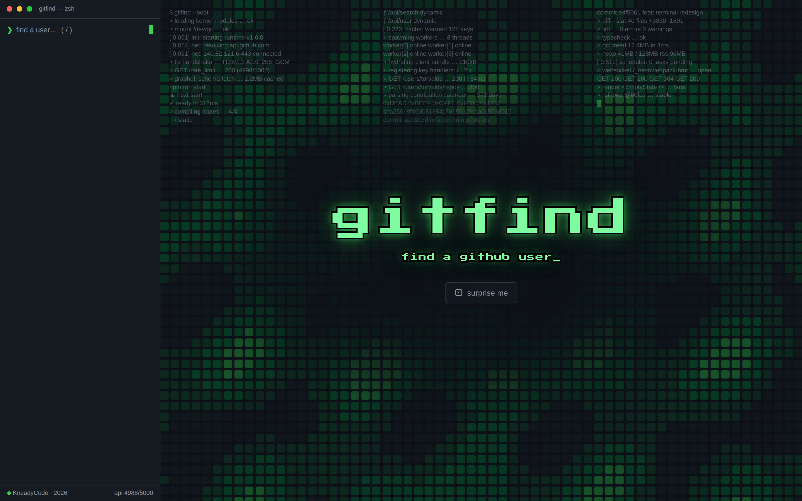
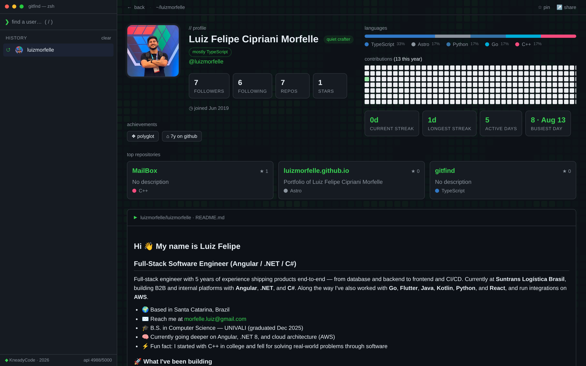

<h1 align="center">gitfind</h1>

<p align="center">
  Find any GitHub user from a terminal-style console.
</p>

<p align="center">
  <a href="https://gitfind-omega.vercel.app"><strong>Live demo →</strong></a>
</p>

<p align="center">
  
  
  
  
  
</p>



## What it is

gitfind is a GitHub profile explorer dressed as a terminal. You type a username,
and instead of a plain card you get a full dossier: language breakdown, the
contribution calendar with streaks, achievement badges, top repositories, the
rendered profile README, recent activity, and the follower/following graph —
all on one screen, with a command bar and keyboard shortcuts for navigation.



## Features

- **Live search** — incremental GitHub user search with debouncing and a local cache.
- **Full profile dossier** — stats, languages, achievements, top repos, activity feed, connections.
- **Contribution calendar** — a year of contributions with current streak, longest streak, active days and busiest day, computed client-side from the GraphQL calendar.
- **README rendering** — profile and repository READMEs rendered inline with GFM, raw HTML sanitized (`rehype-sanitize`) and relative URLs resolved against the repo.
- **Command bar** — `open <user>`, `back`, `random`, plus a few easter eggs (`matrix`, `whoami`, `sudo`, `coffee`).
- **Keyboard-first** — `/` to focus search, `?` for the shortcut sheet, arrows to navigate results.
- **History and pins** — recently viewed users persist locally; pin the ones you keep coming back to.
- **Shareable links and OG images** — every profile is a `?u=<login>` URL, with a social card generated on the fly at `/api/og`.
- **Vibe** — a deterministic personality label derived purely from public stats. No AI, no randomness.

## Stack

Next.js 15 (App Router, Turbopack) · React 19 · TypeScript · Tailwind CSS 4 ·
`@octokit/core` for the GitHub REST and GraphQL APIs · deployed on Vercel.

All GitHub calls go through server-side route handlers under `src/app/api/`, so
the token never reaches the browser.

## Running locally

```bash
git clone https://github.com/luizmorfelle/gitfind.git
cd gitfind
npm install
```

Create a `.env.local` with a GitHub personal access token (classic, no scopes
needed — it only raises the rate limit from 60 to 5000 requests/hour):

```bash
GITHUB_TOKEN=ghp_your_token_here
```

Then:

```bash
npm run dev     # http://localhost:3000
npm run build   # production build
npm run lint    # eslint
```

The app still runs without a token, but REST calls throttle at 60/hour and the
contribution calendar disappears entirely — GitHub's GraphQL API requires
authentication, and the app degrades gracefully when it fails.
`GET /api/rate` reports the remaining quota, and the footer shows it live.

## Project structure

```
src/
├── app/
│   ├── api/          route handlers: search, user, connections, repo-readme, og, rate
│   ├── layout.tsx    fonts, metadata, animated contribution background
│   └── page.tsx
├── components/       UI — terminal shell, profile panels, search, command bar
├── lib/              GitHub client, caching, streaks, favorites, history, vibe
└── models/           GitHub API types
```

## License

MIT — see [LICENSE](LICENSE).
